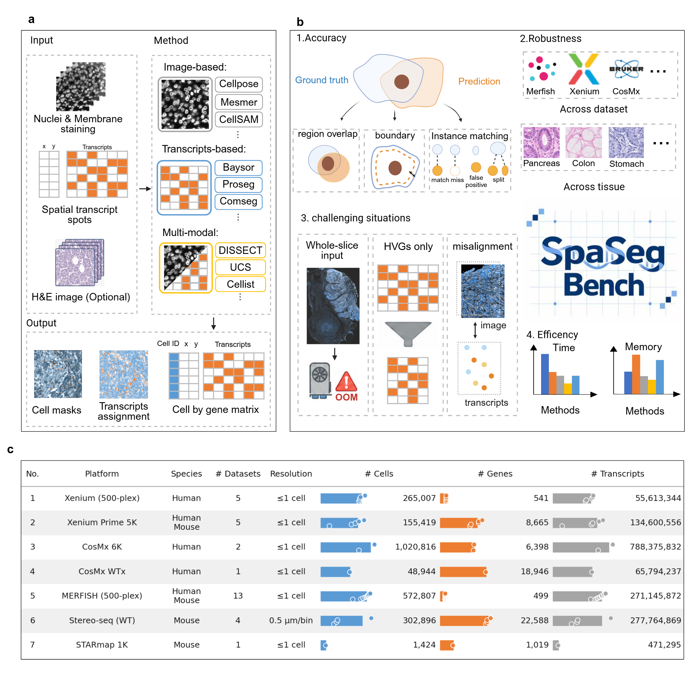

<h1 align="center">
  
   
  SpaSegBench
</h1>

  
  <!-- TODO: Replace the paper badge link with the bioRxiv URL and remove "(TBD)" once available. -->
  
  

  <a href="#overview">Overview</a> &bull;
  <a href="#web-platform">Web Platform</a> &bull;
  <a href="#method">Method</a> &bull;
  <a href="#dataset">Dataset</a> &bull;
  <a href="#citation">Citation</a>

## Overview

Cell segmentation is the step at which spatial transcriptomics (ST) data become single-cell data, and its errors set an upper bound on the reliability of every downstream biological conclusion. Current methods range from image-only models to algorithms that use transcript positions, combine both modalities, or refine an existing segmentation, yet each has mostly been evaluated on its own data and metrics. SpaSegBench provides a unified and reproducible comparison of these methods to guide method selection and future method development.

  

We benchmarked 16 cell segmentation methods on 31 public datasets from seven technology platforms, namely Xenium, Xenium Prime 5K, CosMx 6K, CosMx whole-transcriptome, MERFISH, Stereo-seq, and STARmap, completing 445 of the 466 applicable method–dataset combinations. The datasets cover human and mouse tissues, gene panels from a few hundred genes to the whole transcriptome, and tissues from sparse to dense. We classified the methods along two independent axes. By algorithm, they comprise image-based models, statistical point-cloud models, graph-based models, and image-guided multimodal methods, and by prior dependence, they differ in whether they require an existing segmentation as input. We evaluated segmentation accuracy at both the mask level and the transcript level, robustness across platforms and tissues, performance on whole-slide inputs, different gene panel sizes, and different cell densities, and computational cost in terms of runtime and peak memory. To trace how segmentation errors affect downstream analysis, we further measured transcript contamination between neighbouring cells against protein-defined cell identities obtained from CODEX imaging of the same tissue section.

We found that methods that refine a platform segmentation with transcripts, such as ProSeg and UCS, were the most accurate, and this advantage held on a manually annotated dataset, but they cannot be applied where no such segmentation exists. Image-based models were fast and widely deployable but delineated boundaries poorly, and accuracy depended more on the platform than on the tissue for most methods. For most transcript-based methods, computational cost grew with the number of transcripts, and segmentation errors caused contamination that increased with mask size and neighbour density. No method was therefore both highly accurate and broadly applicable, and the choice of a method should follow the characteristics of the data and the goal of the downstream analysis.

## Web Platform

To make these results useful in practice, we provide a step-by-step segmentation workflow, a compact set of recommended evaluation metrics, and an interactive [web platform](https://wood-321.github.io/SpaSegBench.github.io). The platform allows users to explore results across methods, datasets, platforms, and metrics, and its standardized pipeline allows new methods and datasets to be added to the benchmark. It also hosts SpaSegCompass, a recommendation tool that suggests suitable methods from the characteristics of the user's data, the available hardware, and the requirements of downstream analysis.

## Method

In this work, we present a benchmark study encompassing 16 cell segmentation methods across datasets with varying characteristics and technological platforms. The following methods were included:

- Cellotype: 《CelloType: a unified model for segmentation and classification of tissue images》
- CellSAM: 《CellSAM: a foundation model for cell segmentation》
- Cellpose-3: 《Cellpose3: one-click image restoration for improved cellular segmentation》
- Cellpose-SAM: 《Cellpose-SAM: superhuman generalization for cellular segmentation》
- StarDist 2D: 《Cell detection with star-convex poly-gons》
- Mesmer: 《Whole-cell segmentation of tissue images with human-level performance using large-scale data annotation and deep learning》
- UNSEG: 《UNSEG: unsupervised segmentation of cells and their nuclei in complex tissue samples》
- UCS: 《UCS: A Unified Approach to Cell Segmentation for Subcellular Spatial Transcriptomics》
- BOMS: 《From spots to cells: Cell segmentation in spatial transcriptomics with BOMS》
- ComSeg: 《A point cloud segmentation framework for image-based spatial transcriptomics	Communications Biology》
- GeneSegNet: 《GeneSegNet: a deep learning framework for cell segmentation by integrating gene expression and imaging》
- Proseg: 《Cell simulation as cell segmentation》
- Baysor: 《Cell segmentation in imaging-based spatial transcriptomics》
- Bering: 《Bering: joint cell segmentation and annotation for spatial transcriptomics with transferred graph embeddings》
- Cellist: 《Accurate, scalable and cross-platform cell identification for high-resolution spatial transcriptomics》
- DISSECT: 《Integratingcytological images and spatialtranscriptomics for cell segmentation with DISSECT》

## Dataset

In this work, We benchmark the 16 cell segmentation methods on 31 datasets, include Xenium (10x Genomics), Cosmx, Merfish and so on, which provide multimodal in situ spatial transcriptomics data—including high-resolution fluorescence images and spatially resolved gene expression profiles. The following datasets are as follows:

- **Xenium**
  - [Pancreatic Cancer with Xenium Human Multi-Tissue and Cancer Panel](https://www.10xgenomics.com/datasets/pancreatic-cancer-with-xenium-human-multi-tissue-and-cancer-panel-1-standard)
  - [Xenium v1 Human Breast FFPE with Biomarkers & Housekeeping Genes Custom Panel](https://www.10xgenomics.com/datasets/xenium-ffpe-human-breast-biomarkers)
  - [FFPE Human Lymph Node with 5K Pan Tissue and Pathways Panel](https://www.10xgenomics.com/datasets/preview-data-xenium-prime-gene-expression)
  - [Fresh Frozen Mouse Brain Hemisphere with 5K Mouse Pan Tissue and Pathways Panel](https://www.10xgenomics.com/datasets/xenium-prime-fresh-frozen-mouse-brain)
  - [Human Liver Data with Xenium Human Multi-Tissue and Cancer Panel](https://www.10xgenomics.com/datasets/human-liver-data-xenium-human-multi-tissue-and-cancer-panel-1-standard)
  - [Fresh Frozen Mouse Colon with Xenium Multimodal Cell Segmentation](https://www.10xgenomics.com/datasets/fresh-frozen-mouse-colon-with-xenium-multimodal-cell-segmentation-1-standard)
  - [Preview Data: FFPE Human Prostate Adenocarcinoma with 5K Human Pan Tissue and Pathways Panel](https://www.10xgenomics.com/datasets/xenium-prime-ffpe-human-prostate)
  - [Xenium In Situ Gene and Protein Expression data for Human FFPE Clear Cell Renal Cell Carcinoma (ccRCC)](https://www.10xgenomics.com/datasets/xenium-protein-ffpe-human-renal-ccrcc)
  - [Preview Data: FFPE Human Skin Primary Dermal Melanoma with 5K Human Pan Tissue and Pathways Panel](https://www.10xgenomics.com/datasets/xenium-prime-ffpe-human-skin)
  - [SPATCH: Xenium Prime 5K](https://spatch.pku-genomics.org/#/dataset/xenium)

- **CosMx**
  - [Cosmx-FFPE-Pancreas-dataset-flat-files](https://brukerspatialbiology.com/resources/cosmx-ffpe-pancreas-dataset-flat-files/)
  - [Cosmx-Human-Lymph-Node-FFPE-dataset-flat-files](https://brukerspatialbiology.com/resources/cosmx-human-lymph-node-ffpe-dataset-flat-files/)
  - [CosMx Human Whole Transcriptome Brain Dataset](https://objects.liquidweb.services/smi-public/wtx_manuscript/brain_hippocampus/index_hippocampus.html)

- **Stereo-seq**
  - [MOSTA: Mouse Organogenesis Spatiotemporal Transcriptomic Atlas/E16.5_E2S6](https://db.cngb.org/stomics/datasets/STDS0000058/data)
  - [MOSTA: Mouse Organogenesis Spatiotemporal Transcriptomic Atlas/E14.5_E1S3](https://db.cngb.org/stomics/datasets/STDS0000058/data)
  - [MOSTA: Mouse Organogenesis Spatiotemporal Transcriptomic Atlas/E16.5_E2S7](https://db.cngb.org/stomics/datasets/STDS0000058/data)
  - [Spatial Gene Expression of Mouse Embryo Fresh Frozen Tissue](https://en.stomics.tech/col1370/index.html)

- **MERFISH**
  - [Vizgen MERFISH Mouse Brain Receptor Map](https://info.vizgen.com/mouse-brain-data)
  - [Merscope FFPE Human Immuno-Oncology Data Liver cancer 1](https://info.vizgen.com/ffpe-showcase)
  - [Merscope FFPE Human Immuno-Oncology Data Liver cancer 2](https://info.vizgen.com/ffpe-showcase)
  - [Merscope FFPE Human Immuno-Oncology Data Lung cancer 1](https://info.vizgen.com/ffpe-showcase)
  - [Merscope FFPE Human Immuno-Oncology Data Prostate cancer 1​](https://info.vizgen.com/ffpe-showcase)
  - [Merscope FFPE Human Immuno-Oncology Data Prostate cancer 2](https://info.vizgen.com/ffpe-showcase)
  - [Merscope FFPE Human Immuno-Oncology Data Breast cancer​](https://info.vizgen.com/ffpe-showcase)
  - [Merscope FFPE Human Immuno-Oncology Data Melanoma](https://info.vizgen.com/mouse-brain-data)
  - [Merscope FFPE Human Immuno-Oncology Data Ovarian cancer 1](https://info.vizgen.com/mouse-brain-data)
  - [Merscope FFPE Human Immuno-Oncology Data Ovarian cancer 2](https://info.vizgen.com/mouse-brain-data)
  - [Merscope FFPE Human Immuno-Oncology Data Prostate cancer 1](https://info.vizgen.com/mouse-brain-data)
  - [Merscope FFPE Human Immuno-Oncology Data Prostate cancer 2](https://info.vizgen.com/mouse-brain-data)
  - [Merscope FFPE Human Immuno-Oncology Data Uterine cancer](https://info.vizgen.com/mouse-brain-data)

- **StarMap**
  - [STARmap Mouse VISp 1020 genes](https://github.com/wanglab-broad/ClusterMap/tree/main/datasets/STARmap_V1_1020)

## Citation

If you use SpaSegBench or SpaSegCompass, please cite our paper (citation to be added).
